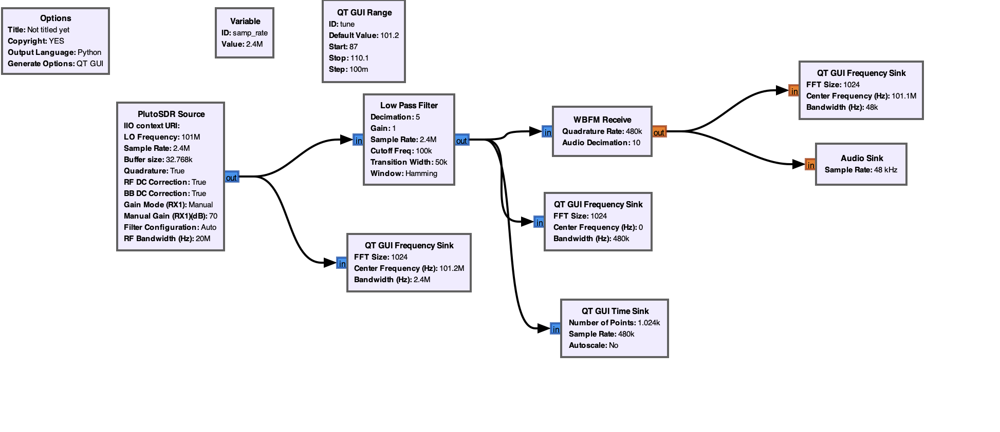
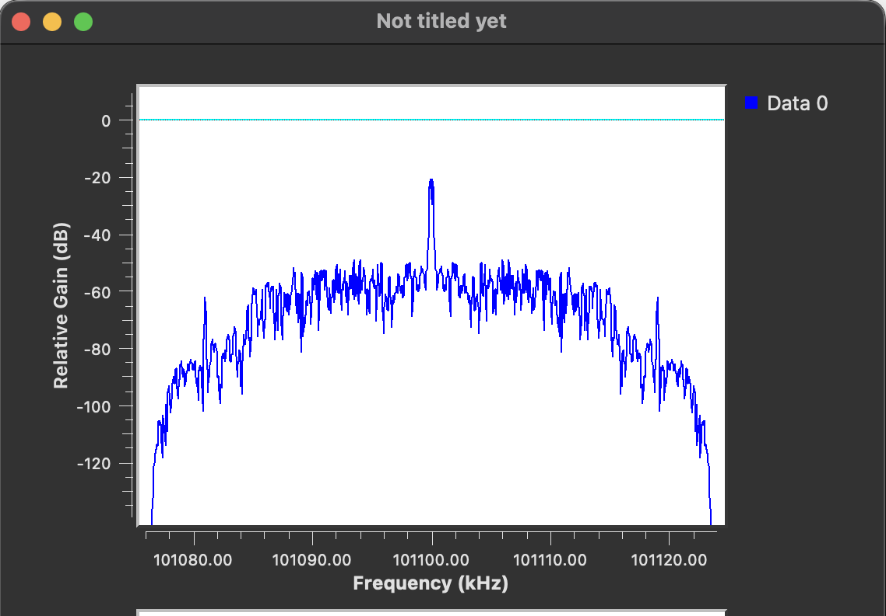

# Программно-определяемое радио на базе ADALM-PLUTO

Лабораторные работы по SDR-платформе **Analog Devices ADALM-PLUTO (PlutoSDR)**: от сборки приёмника в GNU Radio до собственной программы на C/C++ на SoapySDR, передачи сигнала между двумя платами по радиоканалу и цифровой модуляции (BPSK/QPSK).

Репозиторий ведётся по неделям: код и материалы лежат в общих папках, а описание работ собрано в этом README. Подробный отчёт по каждой неделе вынесен в `reports/`.

**ФИО:** Кузеванов Юрий Сергеевич 
**Группа:** ИКС-431

---

## Содержание

1. [Структура репозитория](#структура-репозитория)
2. [Отчёты по неделям](#отчёты-по-неделям)
3. [История разработки по неделям](#история-разработки-по-неделям)
   - [Неделя 1: GNU Radio. Построение FM-радиоприёмника](#неделя-1-gnu-radio-построение-fm-радиоприёмника)

---

## Структура репозитория

```text
├── README.md              # этот файл: описание проекта и сводка по неделям
├── reports/               # подробные отчёты по каждой неделе
├── screens/               # иллюстрации, схемы, графики
└── .gitignore             # *.pcm, build/ и прочий мусор
```

Структура дополняется по мере добавления недель.

---

## Отчёты по неделям

| Неделя | Тема | Отчёт |
|:---:|---|---|
| 1 | GNU Radio. Построение FM-радиоприёмника | [reports/week1.md](reports/week1.md) |

---

## Разработка по неделям

### Неделя 1: GNU Radio. Построение FM-радиоприёмника

**Цель.** Собрать в GNU Radio Companion FM-радиоприёмник на базе Adalm-Pluto, найти частоту реальной радиостанции и получить на выходе слышимый аудиосигнал.

**Что сделано.** Собрана схема: `PlutoSDR Source` (LO 101 МГц, частота дискретизации 2.4 МГц) → `Low Pass Filter` (срез 100 кГц, децимация 5) → `WBFM Receive` (децимация звука 10) → `Audio Sink` (48 кГц), плюс `QT GUI Frequency Sink` и `Time Sink` для контроля спектра и формы сигнала. Частота дискретизации снижается по цепочке 2.4 МГц → 480 кГц → 48 кГц.



**Результат.** Приёмник запущен, на спектре виден выраженный пик на частоте около 101.1 МГц.



Подробнее: [reports/week1.md](reports/week1.md).
