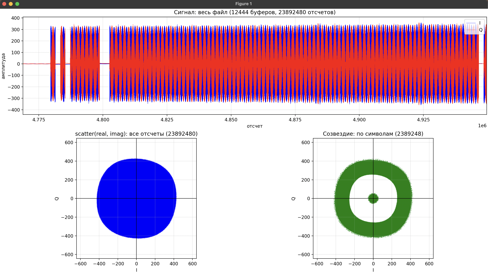
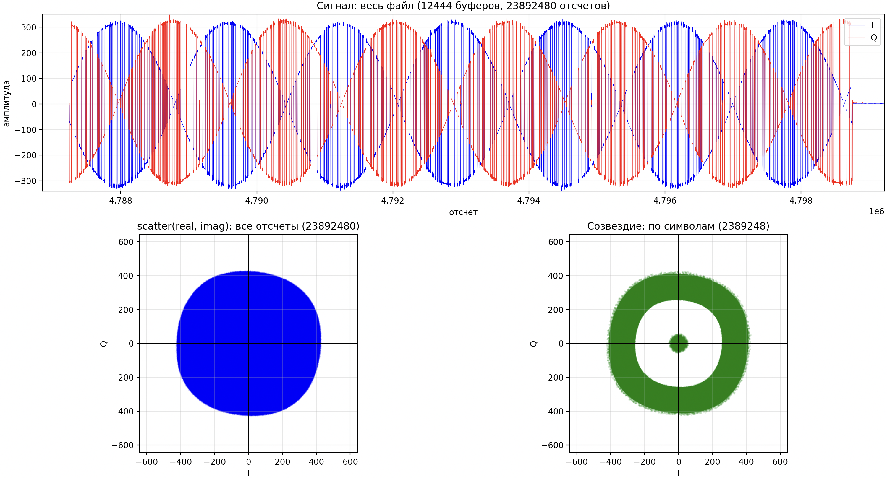
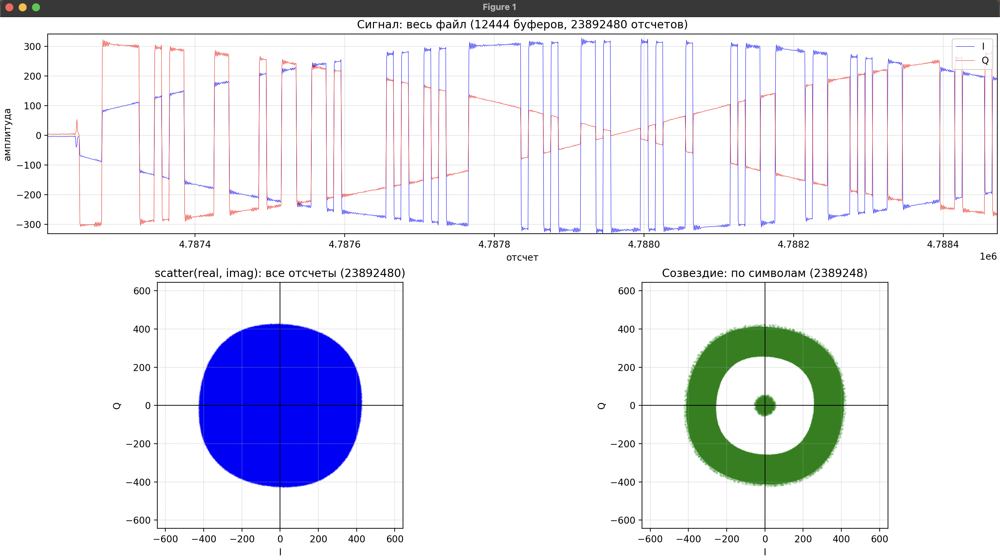

# Отчёт: Неделя 8. Передатчик BPSK/QPSK и начало приёмника

## 1. Цель работы

По заданию занятия: реализовать цепочку передатчика **биты → модуляция → upsampling → свёртка → TX** и начать работу над приёмником: записать принятый сигнал и посмотреть, как он выглядит после прохождения через радиоканал между двумя платами.

## 2. Цепочка передатчика

Передатчик вынесен в набор функций в начале `src/main.cpp`. Параметры:

| Параметр | Значение | Назначение |
|---|---|---|
| `SPS` | 10 | отсчётов на символ |
| `TX_AMPLITUDE` | 2000 | амплитуда символа (максимум для 12-битного ЦАП — 2047) |
| `TX_HEADER_SAMPLES` | 6 | первые 6 комплексных отсчётов буфера занимают флаг и временная метка |
| `MODULATION` | `TX_BPSK` | тип модуляции, `TX_BPSK` или `TX_QPSK` |

Шаги:

1. **Генератор бит** (`generate_bits`): случайные биты `rand() % 2`. Функция `srand` не вызывается, поэтому при каждом запуске получается одна и та же последовательность.
2. **Модуляция** (`map_bpsk`, `map_qpsk`): биты превращаются в комплексные символы (пары `int16`: I и Q).
   - BPSK: 1 бит на символ, бит 0 → `I = +A`, бит 1 → `I = −A`, `Q = 0`.
   - QPSK: 2 бита на символ, первый бит задаёт знак `I`, второй — знак `Q`:

     | `b[2k]` | `b[2k+1]` | `(I, Q)` |
     |:---:|:---:|:---:|
     | 0 | 0 | `(+A, +A)` |
     | 0 | 1 | `(+A, −A)` |
     | 1 | 0 | `(−A, +A)` |
     | 1 | 1 | `(−A, −A)` |

3. **Upsampling** (`upsample_zeros`): после каждого символа вставляется `SPS − 1 = 9` нулевых отсчётов.
4. **Свёртка** (`convolution`): сигнал после upsampling сворачивается с импульсной характеристикой `h`, состоящей из десяти единиц:

   ```c
   static const int16_t h[SPS] = {1, 1, 1, 1, 1, 1, 1, 1, 1, 1};
   ```

   Каждый символ растягивается на 10 отсчётов постоянного уровня, то есть получаются **прямоугольные импульсы**.
5. **Формирование TX-буфера** (`tx_build_buffer`): в буфер из 1920 отсчётов после заголовка (6 отсчётов) помещаются `(1920 − 6) / 10 = 191` символ, то есть 1910 отсчётов; оставшиеся отсчёты обнуляются. Значения умножаются на 16 (сдвиг на 4 бита): ЦАП 12-битный с выравниванием влево, `2000 · 16 = 32000` помещается в `int16`.

Буфер строится один раз до цикла, затем в каждом проходе в заголовок подставляется время отправки (`tx_time = timeNs + 4 мс`) и буфер отправляется с флагом `SOAPY_SDR_HAS_TIME`. Значит, во всех отправленных буферах один и тот же кадр.

## 3. Изменения в программе

По сравнению с версией недель 5–7:

- вместо постоянного уровня `I = Q = 1500 << 4` передаётся сформированный кадр;
- передача идёт на **каждом** буфере, а не только на чётных (условие `buffers_read % 2 == 0` убрано);
- усиление вынесено в константы: приём `RX_GAIN = 10` дБ (раньше 30), передача `TX_GAIN = −40` дБ (раньше 40; как сказано в комментарии к константе, положительные значения у Pluto упираются в 0 дБ, то есть прежнее значение означало максимальную мощность);
- частота дискретизации вынесена в `SAMPLE_RATE`, частоты `rx_freq` и `tx_freq` хранятся как `double` (раньше `int`);
- перед стартом 128 буферов приёма отбрасываются (в очереди могут лежать устаревшие данные);
- обработка Ctrl+C: программа корректно закрывает файл и потоки;
- принятые буферы пишутся в `rxdata.pcm` (режим `rx`) или `txdata.pcm` (режим `tx`) в формате `int16`, I и Q чередуются; файл открывается с перезаписью (`"wb"`), в него пишется ровно столько отсчётов, сколько вернул `readStream`;
- вместо строки по каждому буферу раз в 250 буферов (~0,5 с) печатается статус приёма: пик амплитуды, пометка «только шум» (пик ниже 20) и оценка сдвига частоты между платами в кГц. Оценка берётся по повороту фазы между соседними отсчётами, то есть она приблизительная;
- добавлены проверка создания устройства и вывод параметров запуска (режим, частоты, тип модуляции, MTU).

Частоты те же: `freq1 = 821 МГц`, `freq2 = 766 МГц`, режим `rx` принимает на `freq1` и передаёт на `freq2`, режим `tx` наоборот; константы должны совпадать на обоих ноутбуках.

## 4. Начало приёмника: запись и просмотр принятого сигнала

Приёмник на этом этапе записывает и анализирует сигнал, демодуляции пока нет. Просмотр выполняется скриптом на Python (`scripts/plot_constellation.py`): он читает весь `.pcm`-файл целиком и строит

- сигнал по времени (I — синий, Q — красный); интересующий участок смотрится лупой в окне matplotlib;
- «scatter» всех отсчётов на комплексной плоскости;
- созвездие по одному отсчёту из середины каждого символа (по всему файлу).

Запуск: `python3 scripts/plot_constellation.py build/txdata.pcm`.

## 5. Результаты

Разбирается запись `txdata.pcm`: её сделала плата в режиме `tx`, то есть это сигнал, принятый от второй платы. В файле 12 444 буфера (около 24 с). Рисунки показывают один и тот же график в разном масштабе; значения считаны с графиков и приблизительны.

### 5.1. Вся запись



*Рисунок 1 — участок записи около 4,78–4,95·10⁶ отсчётов; внизу scatter и созвездие по всему файлу.*

- Сигнал приходит пачками из целых буферов (1, 1, 6, затем около 75 подряд) с паузами в 1–2 буфера.
- Амплитуда около ±330 и насыщения АЦП нет (при `RX_GAIN = 30` дБ пик доходил до 2048).
- Созвездие — кольцо, генераторы двух плат расходятся по частоте, и фаза принятого сигнала вращается. Пятно в центре — шум.

### 5.2. Одна пачка из шести буферов



*Рисунок 2 — участок около 11,5 тыс. отсчётов (6 буферов).*

- Огибающие I и Q идут сдвинутыми дугами: когда |I| максимальна, |Q| около нуля, и наоборот. Это вращение фазы BPSK-сигнала.
- Оборот фазы занимает порядка 1–2,5 мс, то есть расхождение частот порядка сотен герц (консольная оценка в одном из запусков была −0,2…−0,5 кГц). Точно значение не измерялось.

### 5.3. Отдельные символы



*Рисунок 3 — Мелкий участок*

- Импульсы прямоугольные, длиной кратной 10 отсчётам: это подтверждает работу upsampling и свёртки.
- I и Q переключаются одновременно, то есть это BPSK. Уровни внутри символа дрейфуют из-за вращения фазы.

## 6. Выводы

1. Реализована цепочка передатчика: генератор бит, модуляция BPSK/QPSK, upsampling нулями и свёртка с прямоугольным окном длиной `SPS = 10`. Кадр из 191 символа помещается в буфер после заголовка с временной меткой.
2. На принятой записи (около 24 с) видны прямоугольные символы длиной по 10 отсчётов, что подтверждает работу upsampling и свёртки и прохождение сигнала по радиоканалу между платами. Принятая амплитуда около ±330 без насыщения АЦП при `RX_GAIN = 10` дБ.
3. Из-за расстройки несущих двух плат фаза принятого сигнала вращается: I и Q превращаются в сдвинутые огибающие, а созвездие размазывается в кольцо. Для демодуляции нужны оценка и компенсация сдвига частоты.
4. Сигнал приходит пачками целых буферов с паузами; причину пропусков нужно выяснить, прежде чем строить приёмник.