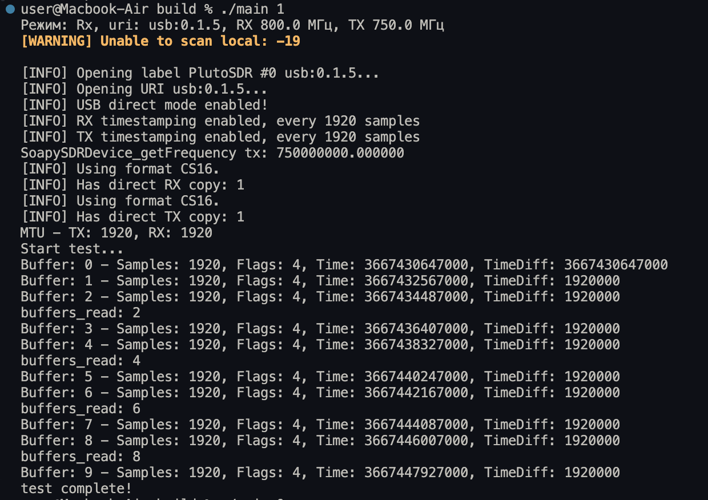
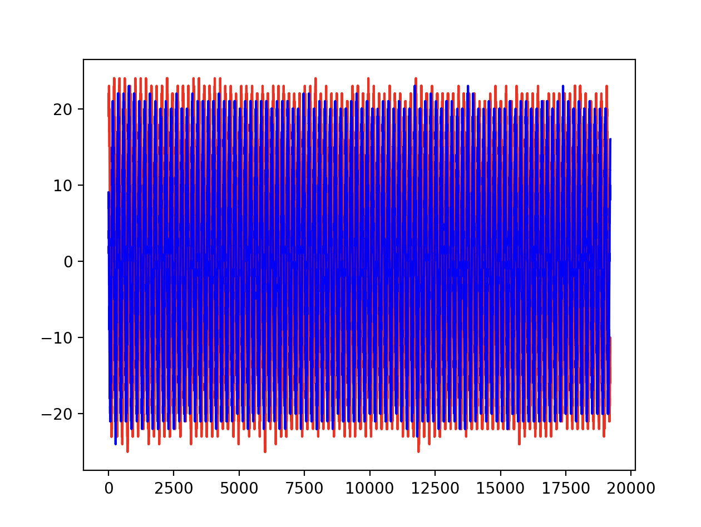

# Отчёт: передача сигнала между двумя ADALM-PLUTO (недели 4–6)

## 1. Цель работы

Передать сигнал с одной платы PlutoSDR на другую по радиоканалу и принять его. Каждая плата подключена к своему ноутбуку, платы между собой проводами не связаны.

## 2. Оборудование и программное обеспечение

- 2 × ADALM-PLUTO (PlutoSDR), каждая подключена к своему ноутбуку по USB;
- SoapySDR с драйвером `plutosdr`, режим `direct`, метки времени каждые 1920 сэмплов (`timestamp_every = 1920`), формат сэмплов CS16;
- программа на C/C++ (`src/main.cpp`), запуск приёмной стороны на MacBook Air (macOS);
- Python 3 (numpy, matplotlib) для построения графиков.

## 3. Схема эксперимента

Одна и та же программа запускается на обоих ноутбуках, режим выбирается аргументом командной строки:

```bash
./main 0 [uri]   # плата "Tx"
./main 1 [uri]   # плата "Rx"
```

`uri` необязателен, по умолчанию `usb:0.1.5` (адрес платы определяется командой `iio_info -s`).

Частоты заданы «крест-накрест»: передача одной платы попадает на приём другой.

| Режим | Аргумент | RX, МГц | TX, МГц | Файл с принятыми сэмплами |
|---|---|---|---|---|
| Tx-плата | `0` | 750 | 800 | `Txdata.pcm` |
| Rx-плата | `1` | 800 | 750 | `Rxdata.pcm` |

Общие параметры: частота дискретизации 1 МГц, усиление RX 30 дБ, усиление TX −40 дБ, размер буфера (MTU) 1920 сэмплов, один канал (`channels = {0}`).

**Передаваемый сигнал.** Буфер из 1920 отсчётов, в котором `I = Q = 2000` (постоянное значение, «прямоугольник»). Начало буфера занимают служебные слова: `FFFF FFFF`, 8 слов с байтами метки времени (сдвинуты на 4 бита) и снова `FFFF FFFF`.

**Тайминг передачи.** Время отправки считается от метки времени принятого буфера: `tx_time = timeNs + 4 мс`, флаг `SOAPY_SDR_HAS_TIME`. Передача идёт на чётных буферах, начиная со второго (2, 4, 6, 8 из 10).

**Формат данных.** Принятые сэмплы пишутся в бинарный файл как `int16` (little-endian), чередуются I и Q.

## 4. Ход работы

1. Начали с передачи между двумя антеннами **одной** платы: TX и RX на одной Pluto, передавался одиночный буфер (сначала «горб» `0.5·(1 − cos)`, затем прямоугольник).
2. Перешли на две платы. Определили, что связь между ними обеспечивается только совпадением частоты и частоты дискретизации: адресации в радиоканале нет, а `uri` нужен лишь для того, чтобы программа нашла свою плату на своём компьютере.
3. Отладили программу и графики (см. раздел 7), попробовали разные формы сигнала: косинус, медленный и быстрый треугольник, прямоугольник.
4. Собрали итоговую программу с выбором режима аргументом и частотами 750/800 МГц (`src/main.cpp`).
5. Запустили приём на плате в режиме Rx, построили график принятых I и Q.

## 5. Результаты

### 5.1 Вывод программы на приёмной стороне



Что видно в выводе:

- режим Rx, `uri = usb:0.1.5`, RX 800 МГц, TX 750 МГц, `getFrequency tx` вернул 750 000 000 Гц, то есть частоты применились;
- включены режим `direct` и метки времени каждые 1920 сэмплов; MTU = 1920 и для RX, и для TX;
- принято 10 буферов по 1920 сэмплов, `Flags: 4` (`SOAPY_SDR_HAS_TIME`, метка времени действительна);
- разность меток времени соседних буферов везде равна 1 920 000 нс (1,92 мс, ровно 1920 сэмплов при 1 МГц), то есть **потерь буферов нет**;
- передача выполнялась на буферах 2, 4, 6, 8, сообщений `TX Failed` нет;
- предупреждение `Unable to scan local: -19` относится к сканированию локальных устройств libiio. На работу оно не повлияло: плата открылась по заданному `uri`.

### 5.2 Принятый сигнал



На графике: красная линия — Q, синяя — I, по оси X номер сэмпла, всего 19 200 сэмплов (10 буферов, 19,2 мс).

- Принят устойчивый периодический сигнал с размахом около ±24 отсчётов АЦП, на фоне которого шум (около ±3 в контрольных записях без передачи) практически не виден.
- Передавалась **константа** (`I = Q = 2000`), а принятые I и Q колеблются вокруг нуля. Это объясняется расстройкой несущих частот (CFO) между независимыми генераторами двух плат: на приёме комплексный сигнал вращается, и I с Q превращаются в колебания.
- Для оценки расстройки на графике укладывается порядка сотни периодов за 19,2 мс, то есть расстройка составляет примерно несколько кГц. Это грубая оценка по картинке, точное значение даст спектр (в работе не измерялось).
- Амплитуда по всей записи примерно постоянна.

## 6. Выводы

1. Две платы Pluto на разных компьютерах работают как независимые радиоустройства. Для связи достаточно совпадения частоты (передача на одной частоте — приём на ней же) и частоты дискретизации, адресации нет.
2. Программа, где режим выбирается аргументом, позволяет использовать один исходник на обеих платах. Схема частот 750/800 МГц «крест-накрест» разводит передачу и приём каждой платы.
3. Приём стабилен: потерь буферов нет, временны́е метки идут строго с шагом 1,92 мс, ошибок передачи нет.
4. Сигнал со второй платы принят с амплитудой около ±24 отсчётов при усилении TX −40 дБ и RX 30 дБ. Тем самым подтверждена работоспособность цепочки передача — приём между двумя платами (оговорки в разделе 8).
5. Из-за расстройки несущих форму передаваемого сигнала нельзя оценивать по отдельным I и Q. Для этого нужно смотреть модуль `|I + jQ|` или спектр, а расстройку частоты оценивать и компенсировать при дальнейшей обработке.
6. Для набора заранее заданных отсчётов (например, диапазона 149 000–243 000 в скрипте выгрузки) запись должна быть длиннее: нужно не менее 130 буферов (130 × 1920 = 249 600 сэмплов), тогда как в текущем запуске их 10.

## 7. Возникшие проблемы и их решение

| Проблема | Причина | Решение |
|---|---|---|
| Ошибка `malloc` при компиляции | файл компилируется как C++, где `void*` не приводится к `int16_t*` автоматически | явное приведение: `(int16_t *)malloc(...)` |
| Ошибки при работе с каналами, не работали 2 канала | у Pluto один канал RX и один TX; в `setGain` вместо номера канала передавался массив | `channels = {0}`, в `setGain` передаётся `channels[0]` |
| На графиках сплошные «палки» вместо формы сигнала | 10–20 млн точек на одном графике, плюс вращение сигнала из-за CFO | смотреть небольшой фрагмент или модуль/огибающую |
| `IndexError` в скрипте выгрузки | диапазон 149 000–243 000 больше записи (19 200 сэмплов) | записывать не менее 130 буферов либо ограничивать диапазон длиной файла |
| Посторонние всплески в записях на 800 МГц | передача ещё не была запущена, а сигнал в записи уже был, то есть он приходил не от второй платы; вероятно, сотовая связь в этом диапазоне (гипотеза, спектроанализатором не проверялось) | временно переходили на 433,92 МГц; в итоговой схеме сигнал принят чисто, но на короткой записи это не доказывает отсутствие помех |

## 8. Что не проверено и дальнейшие шаги

- Принятый сигнал присутствует на всей записи, хотя передача идёт только на нескольких буферах (2, 4, 6, 8). Возможная причина — повтор последнего переданного буфера в TX-очереди платы или более долгий запуск передающей стороны. Это не проверялось.
- Не снималась контрольная запись **при той же схеме 750/800 МГц с выключенной передающей платой**. Без неё нельзя строго утверждать, что весь принятый сигнал пришёл именно со второй платы, а не частично из эфира.
- Не измерялись точная расстройка частот (CFO) и спектр принятого сигнала.
- Следующие шаги: записать не менее 130 буферов с передачей, построить спектр и модуль `|I + jQ|`, оценить и скомпенсировать CFO, передать сигнал с известной структурой (например, последовательность Баркера) и найти её на приёме корреляцией.

## 9. Состав архива

```
weeks 4-6/
├── README.md
├── images/
│   ├── rx_terminal_log.png
│   └── rx_iq_plot.png
├── script.py
└── main.cpp
```
