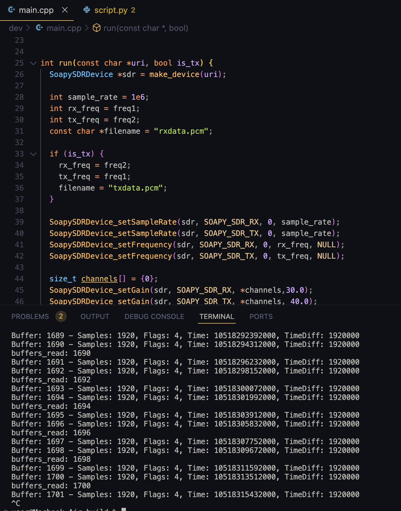
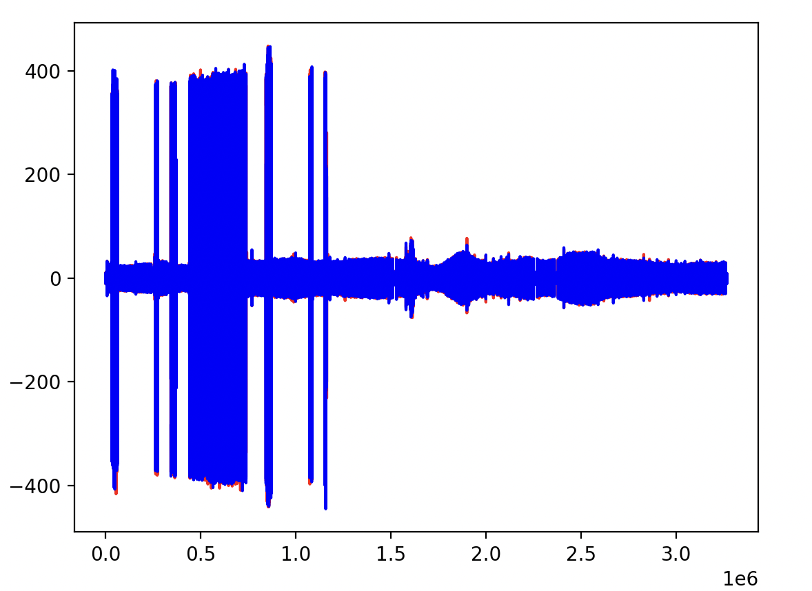
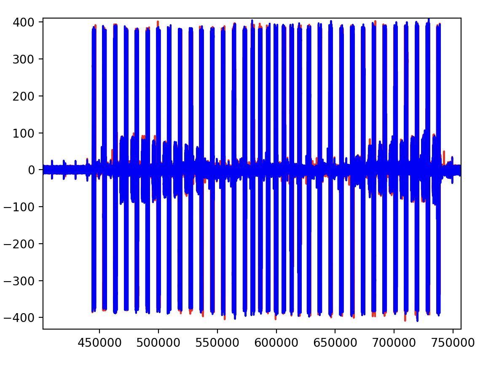
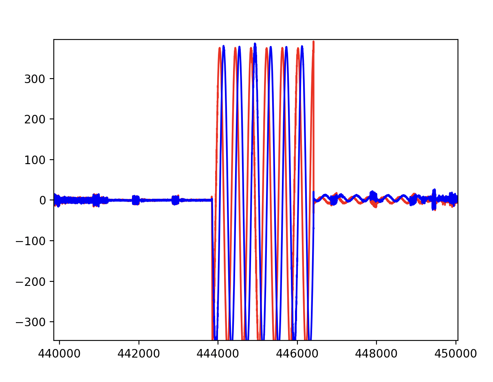

# Отчёт: передача сигнала между двумя ADALM-PLUTO (недели 4–7)

## 1. Цель работы

Передать сигнал с одной платы PlutoSDR на другую по радиоканалу и принять его. Каждая плата подключена к своему ноутбуку.

## 2. Оборудование и программное обеспечение

- 2 × ADALM-PLUTO (PlutoSDR), каждая подключена к своему ноутбуку по USB;
- SoapySDR с драйвером `plutosdr`, режим `direct`, метки времени каждые 1920 сэмплов (`timestamp_every = 1920`), формат сэмплов CS16;
- программа на C/C++ (`main.cpp`); приёмная сторона запускалась на MacBook Air (macOS);
- Python 3 (numpy, matplotlib) для построения графиков (`script.py`).

## 3. Схема эксперимента

Одна и та же программа собирается и запускается на обоих ноутбуках. Режим выбирается аргументом командной строки:

```bash
./main rx [uri]   # плата в режиме "rx"
./main tx [uri]   # плата в режиме "tx"
```

`uri` необязателен, по умолчанию `usb:0.1.5` (адрес платы определяется командой `iio_info -s`).

**Частоты.** В начале программы заданы две константы, которые должны быть **одинаковыми в файлах на обоих ноутбуках**:

```c
int freq1 = 821e6;
int freq2 = 866e6;
```

Режим определяет, какая из них идёт на приём, а какая на передачу («крест-накрест»): передача одной платы попадает на приём другой.

| Режим | RX, МГц | TX, МГц | Файл с принятыми сэмплами |
|---|---|---|---|
| `rx` | freq1 = 821 | freq2 = 866 | `rxdata.pcm` |
| `tx` | freq2 = 866 | freq1 = 821 | `txdata.pcm` |

Общие параметры: частота дискретизации 1 МГц, усиление RX 30 дБ, усиление TX задано как 40,0 (допустимый диапазон TX у Pluto примерно от −89,75 до 0 дБ, поэтому значение, вероятно, ограничивается до максимума), размер буфера (MTU) 1920 сэмплов, один канал (`channels = {0}`).

**Передаваемый сигнал.** Во всех сэмплах буфера `I = Q = 1500 << 4 = 24000` (ЦАП 12-битный с выравниванием влево, поэтому значение сдвинуто на 4 бита). Сигнал постоянный по уровню, то есть это включённая несущая. Первые слова буфера занимает служебный заголовок: `FFFF FFFF`, 8 слов с байтами метки времени и снова `FFFF FFFF`.

**Тайминг передачи.** Время отправки считается от метки времени принятого буфера: `tx_time = timeNs + 4 мс`, флаг `SOAPY_SDR_HAS_TIME`. Передача идёт на каждом чётном буфере, цикл бесконечный (`while (1)`), программа останавливается по Ctrl+C. Прямоугольная форма «импульс — пауза» получается за счёт включения и выключения передачи по буферам: 1,92 мс сигнал, 1,92 мс пауза.

**Формат данных.** Принятые буферы дописываются в бинарный файл (`fopen(..., "a+")`) как `int16` (little-endian), I и Q чередуются.

## 4. Ход работы

1. Начали с передачи между двумя антеннами **одной** платы: TX и RX на одной Pluto, передавался один буфер (сначала «горб» `0.5·(1 − cos)`, затем прямоугольник).
2. Перешли на две платы на разных компьютерах. Связь между ними обеспечивается только совпадением частот и частоты дискретизации: адресации в радиоканале нет, а `uri` нужен лишь для того, чтобы программа нашла свою плату на своём компьютере.
3. Отладили программу и графики (см. раздел 7). Пробовали разные формы сигнала (косинус, треугольник, прямоугольник) и разные частоты (433,92, 800, 821/866 МГц).
4. Собрали программу с выбором режима `rx`/`tx` и бесконечной передачей, записали приём на плате в режиме `rx` и построили графики принятых I и Q.

## 5. Результаты

### 5.1 Запуск программы



На снимке видны фрагмент `main.cpp` и консоль приёмной платы:

- каждый буфер содержит 1920 сэмплов, `Flags: 4` (`SOAPY_SDR_HAS_TIME`, метка времени действительна);
- разность меток времени соседних буферов везде равна 1 920 000 нс (1,92 мс, ровно 1920 сэмплов при 1 МГц), то есть **потерь буферов при приёме нет**;
- строки `buffers_read: N` печатаются на каждом чётном буфере, на них выполняется передача;
- в показанном фрагменте нет строк `TX Failed`;

### 5.2 Вся запись



Красная линия: Q, синяя: I, по оси X номер сэмпла (всего ≈ 3,27·10⁶).

- В первой трети записи (до ≈ 1,2·10⁶ сэмплов) видны пачки с амплитудой до ±400 на фоне слабого сигнала. Среди них выделяется плотный участок от ≈ 0,44·10⁶ до ≈ 0,74·10⁶ сэмплов, внутри которого пачки идут регулярно.
- После ≈ 1,2·10⁶ сэмплов остаётся шум ±30…±50.

### 5.3 Участок с передачей



### 5.4 Один импульс



## 6. Выводы

1. Две платы Pluto на разных компьютерах работают как независимые радиоустройства: для связи достаточно совпадения частоты и частоты дискретизации, адресации нет.
2. Принят сигнал, структура которого соответствует передаваемому: чёткие включения и выключения несущей постоянной амплитуды, длительностью порядка одного буфера. Это подтверждает работоспособность цепочки передача — приём между двумя платами (с оговорками из раздела 8).
3. Приём стабилен: потерь буферов нет, метки времени идут строго с шагом 1,92 мс.
